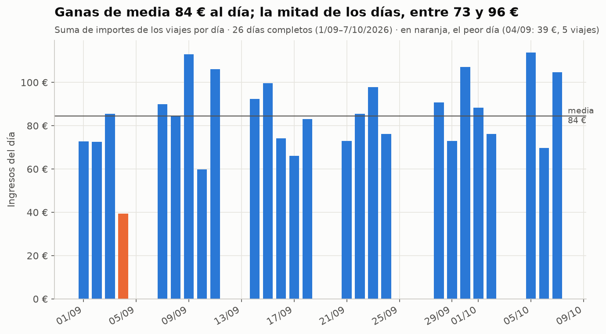
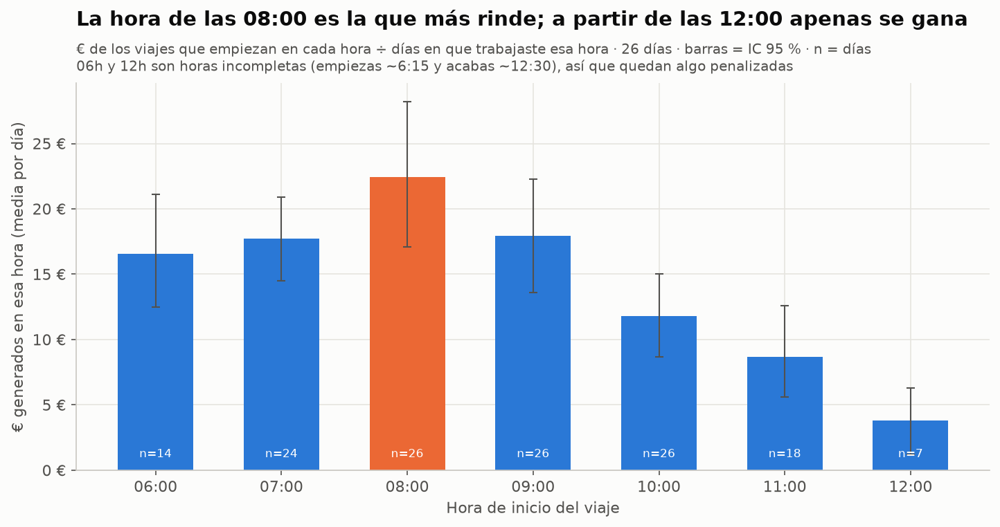

# ¿Cuándo gano más conduciendo en VTC? — Análisis de mis datos reales como conductor VTC

Mi primer proyecto de **Data Analytics**: de 55 fotos de la pantalla del móvil a un análisis validado con Python, SQL, Excel y un dashboard.



## El problema

Soy conductor VTC en una empresa de flota. Quiero saber **cuánto gano por hora**, **qué horas y días rinden más**, **cuánto tiempo pierdo** y **qué cambiaría en mi horario** para ganar más por hora, con datos y no con intuiciones.

## Los datos

- **Origen:** la app no permite exportar, así que fotografié la pantalla: historial de viajes (25 fotos), finanzas, perfil y jornadas de la app de la flota (55 fotos en total).
- **Extracción:** OCR local con el motor Vision de macOS (sin subir nada a internet) y **revisión manual de todas las fotos del historial**.
- **Resultado:** **212 viajes** (31/08–07/10/2026) con fecha, hora, tipo de servicio, importe y método de pago, más **8 jornadas** con el desglose de horas.
- **Validación:** la suma de los viajes coincide **al céntimo** con los totales de la app (septiembre y octubre, por pago en app y en efectivo).
- **Privacidad:** no hay datos de pasajeros, matrículas ni direcciones. Las fotos originales y el texto OCR bruto (donde aparece mi nombre) **no se suben al repositorio** (ver `.gitignore`).

## Método

```
fotos (HEIC) → JPG → OCR local → viajes candidatos (245 filas)
   → correcciones manuales documentadas + deduplicado → 212 viajes
   → limpieza (tipos, zona horaria Europe/Madrid, atípicos, validación)  [01_limpieza.ipynb]
   → análisis exploratorio con tamaños de muestra e IC 95 %             [02_analisis.ipynb]
   → SQL [consultas.sql] · Excel con tablas dinámicas [analisis_vtc.xlsx] · dashboard [dashboard.html]
```

## Hallazgos principales

| Pregunta | Respuesta | Fiabilidad |
|---|---|---|
| ¿Cuánto gano por hora? | **13,1 € brutos por hora de jornada** (IC 95 %: 11,2–14,7); 84 € por día de media | Media (7 jornadas con horas) |
| ¿Qué franjas rinden más? | **08:00–08:59 (22 €/h)**; de 11:00 al cierre, solo **~3,9 €/h** | Buena para 7–10 h |
| ¿Qué días? | Sin ganador claro: los intervalos de confianza se solapan | Débil (4–6 días por día) |
| ¿Qué zonas? | No hay direcciones. Aproximación: los viajes de **aeropuerto** valen un **47 % más** | — |
| ¿Tiempo muerto? | **~1 h 49 min por jornada (26 %)** sin conducción efectiva: esperas, recarga… | Media |
| ¿Esta plataforma o Uber? | **Sin datos de Uber** | — |
| ¿Cancelaciones, propinas, peajes? | **15 % de viajes a 0 €**; propinas, incentivos y peajes < 1 % | Buena |



**Recomendaciones** (detalle en [RESUMEN_EJECUTIVO.md](RESUMEN_EJECUTIVO.md)): revisar el tramo de 11:00 al cierre (cerrar antes subiría el €/hora a ~15,8 €), sacar la recarga de las horas fuertes y probar varias noches, midiéndolas.

## Limitaciones

Solo 5 semanas y solo 8 jornadas con horas; sin costes (el neto no se puede calcular, hay una tabla de escenarios), sin zonas y sin Uber. Todo detallado en [LIMITACIONES.md](LIMITACIONES.md).

## Estructura del repositorio

| Archivo | Qué es |
|---|---|
| [RESUMEN_EJECUTIVO.md](RESUMEN_EJECUTIVO.md) | Una página: hallazgos y recomendaciones |
| [01_limpieza.ipynb](01_limpieza.ipynb) | Limpieza comentada línea a línea |
| [02_analisis.ipynb](02_analisis.ipynb) | Análisis de las 7 preguntas de negocio y gráficos |
| [consultas.sql](consultas.sql) | 14 consultas SQL explicadas (SQLite) |
| [analisis_vtc.xlsx](analisis_vtc.xlsx) | Excel: resumen con fórmulas, gráficos, 4 tablas dinámicas y escenarios de neto |
| [dashboard.html](dashboard.html) | Informe interactivo autocontenido con filtros (se abre con doble clic) |
| [graficos/](graficos/) | 8 gráficos en PNG |
| [GUIA_DE_APRENDIZAJE.md](GUIA_DE_APRENDIZAJE.md) | Explicación de cada paso, glosario y 10 ejercicios |
| [GUIA_POWER_BI.md](GUIA_POWER_BI.md) | 10 pasos para montar el panel en Power BI |
| [INVENTARIO.md](INVENTARIO.md) · [diccionario_de_datos.md](diccionario_de_datos.md) | Qué datos hay y qué significa cada columna |
| [LIMITACIONES.md](LIMITACIONES.md) · [LOG.md](LOG.md) | Límites del análisis y bitácora del proyecto |
| `datos/intermedios/` | Transcripción: candidatos OCR, correcciones manuales, pagos en efectivo, jornadas, totales de la app |
| `datos/limpios/` | Tablas limpias (CSV), registro de cambios y métricas clave |
| `scripts/` | OCR, extracción, SQL, Excel, dashboard y control de calidad |
| `parametros_costes.csv` | Plantilla para calcular tu neto |

## Cómo reproducirlo

Requisitos: Python 3.12 con `pandas`, `matplotlib`, `jupyter` y `openpyxl`.

```bash
pip install pandas matplotlib jupyter openpyxl
```

Desde la carpeta del proyecto:

```bash
jupyter nbconvert --to notebook --execute --inplace 01_limpieza.ipynb
```

```bash
jupyter nbconvert --to notebook --execute --inplace 02_analisis.ipynb
```

```bash
python3 scripts/ejecutar_sql.py
```

```bash
python3 scripts/crear_excel.py
```

```bash
python3 scripts/crear_dashboard.py
```

```bash
python3 scripts/control_calidad.py
```

Los pasos de OCR (`scripts/ocr_vision.swift` y `scripts/extraer_viajes_ocr.py`) necesitan las fotos originales, que no están en el repositorio por privacidad. El repositorio empieza en `datos/intermedios/viajes_ocr_candidatos.csv`.

---
*Proyecto de aprendizaje antes del bootcamp de Data Analytics (octubre de 2026).*
